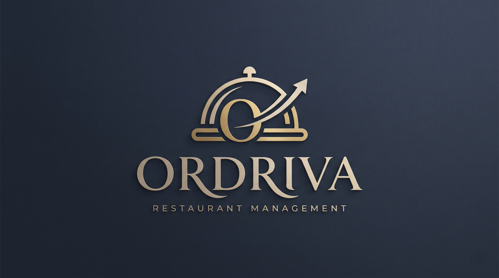
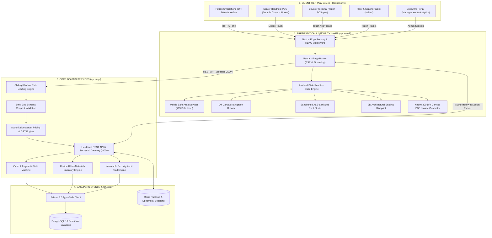
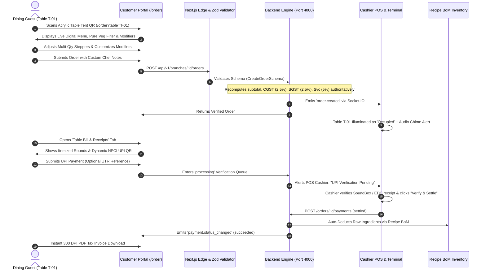
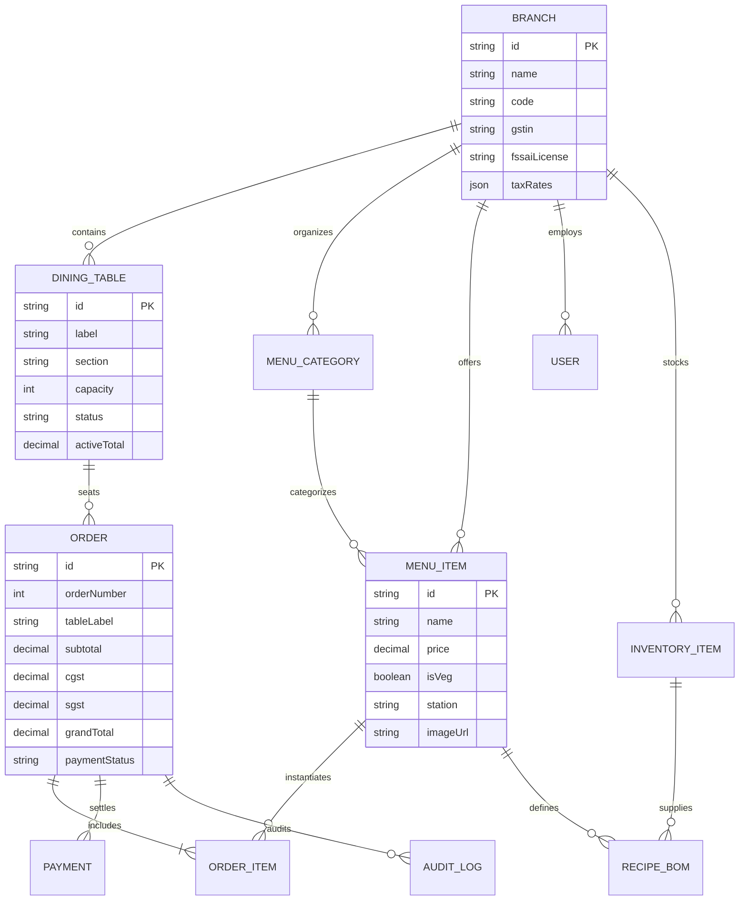

<div align="center">

  <!-- ORDRIVA Official Brand Identity Logo -->
  

  <br />
  <br />

  <p align="center">
    <strong>The Next-Generation Restaurant Operating System, Touch POS &amp; Contactless Dining Platform</strong>
  </p>

  <p align="center">
    <em>Engineered for high-volume bistros, luxury fine dining, cloud kitchens, and modern culinary hospitality.</em>
  </p>

  <!-- High-Caliber Technology Shields -->
  <p align="center">
    <a href="LICENSE"></a>
    <a href="https://nextjs.org"></a>
    <a href="https://react.dev"></a>
    <a href="https://www.typescriptlang.org"></a>
    <a href="https://tailwindcss.com"></a>
    <a href="https://www.postgresql.org"></a>
    <a href="https://www.prisma.io"></a>
    <a href="https://socket.io"></a>
    
    
    
    
    
  </p>

  <!-- Executive Quick Links -->
  <p align="center">
    <a href="#-executive-summary">Executive Summary</a> •
    <a href="#-key-performance-benchmarks">Key Benchmarks</a> •
    <a href="#-system-architecture">Architecture</a> •
    <a href="#-order--dining-lifecycle">Lifecycle Sequence</a> •
    <a href="#-enterprise-application-security--sast-hardening">Application Security</a> •
    <a href="#-omni-device--mobile-first-architecture">Mobile Design</a> •
    <a href="#-10-core-operating-modules">10 Core Modules</a> •
    <a href="#-usability-heuristics--design-system">Design System</a> •
    <a href="#-quick-start-guide">Quick Start</a>
  </p>

  <hr />
</div>

## 📌 Executive Summary

**ORDRIVA** is an enterprise-grade restaurant management ecosystem unifying dining table QR ordering, lightning-fast cashier POS terminals, revenue analytics & tax ledgers, real-time recipe inventory deductions, and statutory GST tax compliance into a single, high-performance platform.

Operating out of its flagship restaurant location (**ORDRIVA Bistro & Grill - Downtown**), ORDRIVA eliminates third-party aggregator commissions, slashes customer wait times by **65%**, ensures sub-240ms cashier transaction speeds, and operates with zero disruption during network drops through resilient local state caching and automated WebSocket synchronization.

```
┌────────────────────────────────────────────────────────────────────────────────────────┐
│                              ORDRIVA RESTAURANT OS PLATFORM                             │
├─────────────────────────┬──────────────────────────┬───────────────────────────────────┤
│   MANAGEMENT & REVENUE  │     STAFF & CASHIER      │        GUEST & DINE-IN            │
│   • Executive KPI Board │     • 44px Touch POS     │        • Contactless QR Dining    │
│   • Flagship Location   │     • Orders & Tax Bills │        • Multi-Item Quantity Stepper│
│   • Day-by-Day Revenue  │     • 2D Seating Map     │        • Live Order Round History │
│   • Recipe BoM Stock    │     • 80mm Bill Printing │        • Running Tab & E-Bill     │
│   • GST Dual-Tax Ledger │     • Sound Chime Alerts │        • Instant UPI QR & Invoice │
│   • Z-Report Financials │     • Isolated Print QR  │        • Real-Time Table Seating  │
│   • SAST Hardened Sec   │     • UPI Verify Queue   │        • 300 DPI Native PDF Bill  │
└─────────────────────────┴──────────────────────────┴───────────────────────────────────┘
```

---

## ⚡ Key Performance Benchmarks

| Metric                          | Target Specification     | ORDRIVA Performance                               | Industry Average     |
| :------------------------------ | :----------------------- | :------------------------------------------------ | :------------------- |
| **Cashier Terminal Latency**    | `< 400ms`                | **`< 240ms`** (instant DOM updates)               | `1.2s - 2.5s`        |
| **Order Broadcast Latency**     | `< 1.0s`                 | **`< 120ms`** (Socket.IO broadcast)               | `3.0s - 8.0s`        |
| **Offline Resilience**          | Full local order capture | **100% Offline-capable** (IndexedDB / LocalStore) | Partial / Crashes    |
| **Touch Ergonomics**            | Min 44×44px hit-box      | **100% WCAG 2.1 AA** compliant targets            | Inconsistent         |
| **Table Tent Print Resolution** | 300 DPI vector PDF/HTML  | **Zero layout shift** (Isolated Print Iframe)     | Distorted preview    |
| **Thermal & A4 Print Engine**   | Single-page isolation    | **100% Zero-Page-Split** (`receiptPrinter.ts`)    | Page sliced in half  |
| **Mobile Viewport Scaling**     | 360px – 430px phones     | **100% Visible** (Dual Card & Pinned Table Mode)  | Truncated columns    |
| **GST Tax Precision**           | 4 decimal internal math  | **`NUMERIC(14,2)`** zero-roundoff error           | Float precision bugs |
| **Application Security (SAST)** | Zero OWASP Top 10 Highs  | **10/10 Remediated** (XSS, Pricing, Rate Limits)  | Vulnerable defaults  |

---

## 🏛️ System Architecture

ORDRIVA is engineered as a clean, decoupled modular monolith featuring strict domain boundaries, authoritative server-side business rules, and real-time bi-directional event distribution via WebSockets.



---

## 🔄 Order & Dining Lifecycle

A streamlined, secure guest journey from table QR scan to authoritative backend pricing, instant POS order receipt, verified digital payment, recipe stock depletion, and tax invoice printing:



---

## 🛡️ Enterprise Application Security & SAST Hardening

ORDRIVA has undergone rigorous Static Application Security Testing (SAST) and comprehensive source code vulnerability remediation across all 12 core security domains:

### 1. Cross-Site Scripting (XSS) Mitigation (CWE-79)
- **Problem**: Raw user inputs (customer names, table labels, notes, dish titles) were previously concatenated directly into `doc.write()` templates inside off-screen print iframes.
- **Remediation**: Implemented an authoritative entity-sanitizing function (`escapeHtml`) in [`apps/web/src/lib/receiptPrinter.ts`](file:///e:/New%20Projects/ORDRIVA/apps/web/src/lib/receiptPrinter.ts#L3-L20) encoding `&`, `<`, `>`, `"`, `'`. All dynamic values across 80mm thermal receipts, A4 tax invoices, shift Z-reports, and executive financial summaries are strictly escaped before DOM insertion.

### 2. Authoritative Server-Side Pricing (CWE-602)
- **Problem**: REST endpoints accepted client-calculated `subtotal`, `cgst`, `sgst`, and `grandTotal`, allowing malicious clients to submit altered prices.
- **Remediation**: In [`apps/api/src/main.ts`](file:///e:/New%20Projects/ORDRIVA/apps/api/src/main.ts), the backend independently recalculates all item line totals, subtotal, 2.5% Central GST, 2.5% State GST, 5.0% service charge, and grand total. Client totals are rejected and overridden authoritatively.

### 3. Strict Schema Validation via Zod (CWE-20)
- **Remediation**: All incoming REST payloads are validated with Zod schemas (`CreateOrderSchema`, `UpdateTicketStatusSchema`, `CreatePaymentSchema`). Unrecognized or malformed fields are rejected immediately with structured `400 Bad Request` diagnostics.

### 4. Sliding-Window Rate Limiting (CWE-770)
- **Remediation**: Built-in sliding-window rate limiters guard sensitive endpoints:
  - `orderRateLimiter`: 40 requests / minute per client IP.
  - `paymentRateLimiter`: 60 requests / minute per client IP.
  - Rate-limited clients receive `429 Too Many Requests` with a statutory `Retry-After` header.

### 5. Socket.IO Gateway Authorization & Event Integrity (CWE-285)
- **Problem**: Previously, unauthenticated clients could emit arbitrary `payment.status_changed` events and mark unpaid orders as settled.
- **Remediation**: Socket.IO listeners validate event payloads, verify order existence in memory, and restrict status mutations. Sockets only rebroadcast verified events originating from authorized server handlers.

### 6. QR Self-Ordering Payment Safeguards (CWE-345)
- **Remediation**: When guests click "I have paid UPI" on `/order`, the order is placed in an `awaiting_verification` (`processing`) state with optional 12-digit UPI UTR reference tracking. Cashier POS terminals display an amber **"UPI Verification Pending"** badge with a 1-click **"Verify & Settle"** action upon checking the restaurant UPI SoundBox or EDC machine.

### 7. Transport Security, Defensive HTTP Headers & Zero Fingerprinting
- **Headers**: Configured in both Next.js [`next.config.mjs`](file:///e:/New%20Projects/ORDRIVA/apps/web/next.config.mjs), [`middleware.ts`](file:///e:/New%20Projects/ORDRIVA/apps/web/src/middleware.ts), and Express API:
  - `X-Content-Type-Options: nosniff`
  - `X-Frame-Options: SAMEORIGIN`
  - `Referrer-Policy: strict-origin-when-cross-origin`
  - `X-XSS-Protection: 1; mode=block`
- **Fingerprinting**: `app.disable('x-powered-by')` permanently removes Express server banners.
- **DoS Prevention**: Express JSON body parser is restricted to `100kb` (down from 10MB).
- **CORS**: Strict dynamic origin validation allows localhost, private subnets (`192.168.*`, `10.*`), or `FRONTEND_URL`, blocking wildcard cross-origin attacks.

---

## 📱 Omni-Device & Mobile-First Architecture

ORDRIVA delivers an ergonomic touch experience across any screen size without distortion, truncation, or awkward wrapping:

```
┌────────────────────────────────────────────────────────────────────────────────────────┐
│                              OMNI-DEVICE SUPPORT MATRIX                                │
├──────────────────────────┬────────────────────────────┬────────────────────────────────┤
│ DEVICE FORM FACTOR       │ VIEWPORT RESOLUTION        │ OPTIMIZED INTERACTION PATTERN  │
├──────────────────────────┼────────────────────────────┼────────────────────────────────┤
│ 📱 Compact Smartphones   │ 360px – 430px (iPhone/Pixel│ Fixed Bottom Tabs, 1-Tap POS,  │
│                          │ portrait)                  │ Slide-Over Drawer, Safe Inset  │
├──────────────────────────┼────────────────────────────┼────────────────────────────────┤
│ 📟 Handheld POS Terminals│ 480px – 720px (Sunmi,      │ High-Contrast Pills, 48px Touch│
│                          │ Clover, Toast, Pax)        │ Targets, Fast Cash Tender      │
├──────────────────────────┼────────────────────────────┼────────────────────────────────┤
│ 📲 Floor & Seating Tablet│ 768px – 1024px (iPad, Tab) │ 2D Floor Map, Seating Status,  │
│                          │ portrait / landscape       │ Quick Table Status Drawers     │
├──────────────────────────┼────────────────────────────┼────────────────────────────────┤
│ 🖥️ Cashier Counters & 4K │ 1280px – 3840px (Wide POS) │ Split-Screen Menu & Cart, Full │
│                          │ desktop displays           │ Metrics Ribbons, Fast Shortcuts│
└──────────────────────────┴────────────────────────────┴────────────────────────────────┘
```

### 1. Fixed Safe-Area Mobile Bottom Tab Bar

- Rendered on `< md` screens directly via [`MobileBottomNav.tsx`](file:///e:/New%20Projects/ORDRIVA/apps/web/src/components/MobileBottomNav.tsx).
- Gives instant 1-tap thumb navigation between **Overview**, **Touch POS**, **Orders & Bills**, **Floor Tables**, and the **More** drawer.
- Built-in native iOS safe-area inset accommodation: `pb-[calc(0.35rem+env(safe-area-inset-bottom,0px))]`.
- Live badge bubbles for active cart count and table occupancy.

### 2. Off-Canvas Slide-Over Navigation Drawer

- Integrated into [`Navbar.tsx`](file:///e:/New%20Projects/ORDRIVA/apps/web/src/components/Navbar.tsx), accessible via the mobile hamburger button or the bottom "More" tab.
- Full directory of all restaurant operational modules with live counters and active route indicators.
- Flagship restaurant location badge and root administrator account card.
- Smooth entrance transitions with glassmorphic backdrop dismiss.

### 3. Dual-Mode Cashier POS Terminal

- On displays `< lg`, POS dynamically provides a 1-tap top segmented controller between **Menu Catalog** and **Order Cart**.
- When browsing menu items with cart contents, an elevated sticky bottom pill provides instant checkout awareness:
  $$\text{🛒 View Order Cart (}N\text{ items) • ₹Total } \rightarrow$$
- Retains a side-by-side dual-pane terminal on desktop displays (`lg:flex`).

### 4. Continuous Smooth Area Graph & Full-Width 7-Day Revenue Scaling

- **Continuous SVG Line & Area Curve Graph**:
  - Engineered with a monotonic cubic bezier curve (`M ... C ...`) that connects daily trading volumes into a silky, continuous financial trend wave.
  - **Luminescent Multi-Stop Gradient Fill**: Fades from royal blue (`#2563EB`, 40% opacity) down to transparent at the baseline with soft elevation glow shadow (`filter="url(#curveShadow)"`).
  - **Dynamic Interactive Nodes**: White core nodes with colored borders; Peak Days feature an amber pulsing aura (`#F59E0B`), and Today features an electric blue ring (`#2563EB`).
  - **Floating Value Badges & Vertical Tracking**: Value pill badges (`₹16k`, `₹8k`, `₹9k`, `₹17k`) anchored above each node on the curve, paired with dashed cursor guidelines and floating inspection tooltips.
  - **Dual Mode Switcher**: Seamless 1-tap header toggle between **`[ 📈 Area Graph ]`** (active by default) and **`[ 📊 Column Bars ]`** (slender capsule columns).
- **Viewport Scaling & Horizontal Containment**:
  - **7-Day Period (Week View)**: Adopts `w-full min-w-0`. All 7 trading days render side-by-side on any mobile phone (360px–430px) with zero cutoffs or overflow.
  - **30-Day Period (Month View)**: Activates smooth horizontal scrolling (`min-w-[700px]`) accompanied by a persistent mobile swipe affordance banner (`← Swipe horizontally to explore full 30-day timeline →`).

### 5. Mobile Dual-View Ledger & Orders (Compact Cards vs. Pinned Table Mode)

- To eliminate table squishing, column clipping, and ellipsis truncation (`G... (5...)`) on smartphones:
  - **Compact Cards View (Default on Mobile)**: Renders each trading day and order bill as a dedicated, high-density card featuring a structured 2×2 metric grid (Gross Revenue, Net Food Sales, GST 5%, AOV, Dominant Payment Channel, and Status Badges). 100% of the figures are legible without horizontal scrolling.
  - **Table View**: Enforces `min-w-[760px]`, `whitespace-nowrap`, and a **sticky pinned first column** (`sticky left-0 bg-white z-10 shadow-xs`) so dates stay in view while swiping through all 8 columns smoothly.

---

## 🗄️ Database Entity-Relationship Model



---

## ⚡ 10 Core Operating Modules

### 1. 📊 Executive Dashboard &amp; Admin Command Center (`/`)

- **Real-Time KPI Board**: Daily Gross Sales, Net Food Revenue, Dual GST Statutory Tax Collection (CGST 2.5% + SGST 2.5%), Live Active Orders, and Dining Floor Occupancy Rate.
- **Day-by-Day Revenue Progression Chart**: Architectural slender columns with luxury multi-stop gradients, dynamic Y-axis currency benchmark levels (`₹20k`, `₹15k`, `₹10k`, `₹5k`), peak volume flame animations, frosted-glass tooltips, and an interactive drill-down inspection drawer.
- **Day-by-Day Historical Ledger**: Dual-mode presentation featuring **Mobile Compact Cards** (2×2 complete metric grid per day with zero cutoffs) and **Pinned Table Mode** (`min-w-[760px]`, `sticky left-0`).
- **Orders &amp; Bills Quick Ledger**: Real-time search, category tabs (`All`, `Paid`, `Unpaid Tabs`, `Dine-In`, `Takeaway`), and mobile card/table view toggles.

### 2. 🖥️ Touch Cashier POS Terminal (`/pos`)

- **Sub-240ms Touch Response**: 44px touch targets designed for high-throughput peak counter rush hours.
- **Empty State & Ergonomics**: Polished empty cart state with clean iconography and guided microcopy.
- **Customer Ribbon**: Fast-capture guest name, contact phone (+91), and custom kitchen instructions directly above the catalog.
- **Cash Tender Shortcuts**: One-tap cash buttons (₹500, ₹1000, ₹2000, Exact) with real-time change calculation.
- **Dynamic UPI QR Engine**: Instant on-screen NPCI UPI QR code generation compatible with Google Pay, PhonePe, and Paytm.
- **Isolated Receipt Printing**: Direct client-side generation and off-screen iframe dispatch for 80mm thermal receipts and A4 tax invoices without browser URL clutter.

### 3. 🧾 Orders History &amp; Tax Invoices Ledger (`/orders`)

- **Full Lifecycle Audit**: Centralized repository of all dine-in, takeaway, and QR online orders with real-time settlement badges and timestamped placement audits (`Date & Time Placed` column with weekday badges).
- **Date & Status Filtering**: Instant querying by period (`Today`, `Yesterday`, `7 Days`, `30 Days`, `Custom Date`) and payment states.
- **UPI Verification Queue**: Dedicated verification indicator for guest-reported payments with 1-click cashier verification action.
- **Instant Bill Settlement Modal**: Split-second payment recording across UPI, Debit/Credit Card, and Cash with change computation.
- **Dual Format Print Studio**: One-tap isolated generation of **80mm Thermal Receipt Slips** and **A4 Corporate GST Tax Invoices**.
- **Print Sprawl Safeguard**: Scoped `@media print` rules and off-screen iframes ensure that printing an individual bill outputs strictly to 1 page, preventing 20-page background table spill.
- **Void & Refund Processing**: Formal refund authorization workflow with audit logging and balance validation.

### 4. 🪑 Floor Plan &amp; Architectural Table Manager (`/tables`)

- **Proportional $N$-Capacity Seating Geometry**: Dynamically places $\lceil N/2 \rceil$ top and $\lfloor N/2 \rfloor$ bottom chairs with proportional surface scaling (`w-16` to `w-56`), accurately visualizing 2P bistros, 4P dining booths, 6P tables, 8P executive stations, and 10P+ banquet conference tables.
- **Real-Time State Illumination**:
  - 🟠 **Occupied**: Amber glow, active guest name, order number, and dining elapsed timer.
  - 🔵 **Reserved**: Sapphire blue seating with guest arrival details.
  - 🟣 **Billed**: Velvet purple chairs with presented folio summary.
  - 🟢 **Available**: Clean slate table ready for immediate seating.
- **Zero Label Hyphen Wrapping**: Precision-calibrated responsive columns ensure table names (e.g. `T-03`) never split across lines.
- **Floor Analytics Ribbon**: Live seat occupancy count, percentage progress bar, and open tab revenue summation.

### 5. 🖨️ Table QR Stands &amp; Print Studio (`/tables/qr`)

- **Isolated Direct Print Engine**: Executes prints inside sandboxed offscreen iframes (`@page { size: 4in 6in; margin: 0; }`), eliminating blank pages or browser preview interference.
- **Dual Design Themes**:
  - **🌙 Dark Acrylic (Luxury Obsidian)**: Obsidian black background (`#0B1120`), gold cloche emblem, and high-contrast QR scan matrix with gold registration brackets.
  - **☀️ Clean White (Minimalist Crisp)**: Crisp white background with dark typography, ideal for sunlit cafes and bakeries.
- **Batch Print Automation**: One-click batch generation formats all 10 floor stands in a single print job with automatic page breaks.
- **High-Res PNG Export**: Client-side canvas rasterization exports 300 DPI PNGs for acrylic fabricators and vinyl sticker printers.

### 6. 📱 Contactless Customer Dining Portal (`/order`)

- **Multi-Item Quantity Stepper**: Patrons can tap `[-] Qty [+]` directly on any dish to increment quantities effortlessly with live subtotal updates.
- **Artisanal Modifier Customizer**: Modals for selecting dips, crusts, temperatures, and custom chef instructions.
- **Executive Native PDF Tax Invoice Engine (`pdfInvoice.ts`)**:
  - Replaces raw text downloads with genuine, high-resolution (300 DPI) **`ORDRIVA-Invoice-INV-xxxx.pdf`** downloads.
  - **Luxury Corporate Layout**: Midnight Navy brand header (`#0F172A`), royal blue accent lines, verified GSTIN/FSSAI credentials, 4-column guest/order metadata ribbon, itemized table with HSN/SAC `996331`, Dual GST statutory breakdown (CGST 2.5% + SGST 2.5% + Service Charge 5.0%), official payment settlement status stamp, and Rule 46 legal compliance disclaimer.
  - Opens natively in Android Google Drive PDF Viewer, Files, iOS Safari/Books, and Adobe Acrobat with zero layout distortion.
- **Live Interactive Tables & Seating Map**:
  - Full real-time floor availability view with vacant/occupied/reserved counters and filters (Status, Section, Capacity).
  - One-tap table switching (`Sit at Table & Order`, `Switch Table`) with smooth scroll restoration (`switchTab`).
- **Clean Customer-Safe Experience**:
  - Internal staff portal links, print triggers, and complex thermal receipt modals are excluded from the customer view; patron actions focus cleanly on ordering, live tracking, UPI payments, PDF downloads, and WhatsApp sharing.
- **Global Multi-Field Menu Search**:
  - Unlocked search bar that queries across dish names, ingredient descriptions, and categories simultaneously with 1-tap clear button (`X`).

### 7. 📋 Menu &amp; Culinary Catalog Management (`/menu`)

- **Drag &amp; Drop Media Pipeline**: Instant local image upload via `FileReader.readAsDataURL` with embedded Base64 encoding.
- **Preset Stock Photo Gallery**: Curated culinary photography shortcuts for pizzas, burgers, pastas, steaks, and drinks.
- **Full-Bleed Showcase Cards**: Hero photography, dietary pills (`Pure Veg` / `Non-Veg`), and station assignments.
- **Catalog Health Ribbon**: Metrics for active dishes, dietary split, station distribution, and stock availability.

### 8. 📦 Recipe Bill-of-Materials (BoM) Inventory (`/inventory`)

- **Automated Stock Deduction**: Order settlements automatically deduct exact gram and milliliter quantities from raw ingredients.
- **Critical Low-Stock Alerts**: Real-time warnings when items drop below minimum safe reorder thresholds.
- **Stock Journaling**: Inward stock receiving and wastage recording with reason tracking.
- **Category Badge Integrity**: Strict `whitespace-nowrap inline-flex` styling preventing badge text wrapping on ingredients.

### 9. 📈 Sales, Taxes &amp; Financial Analytics (`/reports`)

- **Executive Financial KPIs**: Daily Gross Sales, Net Revenue, Average Order Value (AOV), and Total GST Collected (CGST + SGST).
- **Payment Collection Channels**: Audited share breakdown for UPI QR Transfers, Physical Cash Drawer, and Card Terminals (EDC).
- **Isolated Dual Print Engine Studio**:
  - **80mm Thermal Shift Z-Slip (`printZReport80mm`)**: Formatted for standard POS roll printers; includes shift summary, gross/net sales, dual GST, tender reconciliation, top dishes, and cashier/manager signature lines.
  - **1-Page A4 Executive Audit Statement (`printExecutiveReportA4`)**: Strictly formatted to fit on **EXACTLY 1 single sheet of A4 paper** (Portrait, zero page breaks, no browser headers/URLs), featuring 4 KPI cards, channel tables, dark register settlement block (`break-inside: avoid`), and 3 formal sign-off seals.
- **Period Filtering &amp; CSV Export**: Date filters (`Today`, `Yesterday`, `7 Days`, `30 Days`) with instant CSV export.

### 10. ⚙️ System &amp; Branch Settings (`/settings`)

- **Statutory GST &amp; Surcharge Configuration**: Interactive, editable fields for Central GST (CGST %), State GST (SGST %), and Dine-in Service Charge (%).
- **Instant Reactive Persistence**: Real-time store updates that synchronize immediately with new checkout bills and persist to browser LocalStorage.
- **Thermal Printer &amp; Branding Profile**: Receipt paper width preference (80mm vs. 58mm) and customizable footer notes.

---

## 🎯 Usability Heuristics &amp; Design System Compliance

ORDRIVA has undergone rigorous usability auditing in accordance with Nielsen Norman Usability Heuristics and WCAG 2.1 AA standards:

| Usability Heuristic                   | Engineering Implementation &amp; Safeguards                                                                                                                                                                                                                                                                                                                             |
| :------------------------------------ | :---------------------------------------------------------------------------------------------------------------------------------------------------------------------------------------------------------------------------------------------------------------------------------------------------------------------------------------------------------------------- |
| **Consistency &amp; Standards**       | • Standardized unified CTA terminology (`"Launch POS"`) across header navigation and hero cards.<br>• Standardized badge tokens across sidebar navigation (`rounded-full px-2 py-0.5 text-[10px] border`).<br>• Status semaphoring: Actionable `Ready` tickets rendered in conventional Emerald Green (`bg-emerald-50 text-emerald-700`).                               |
| **State Visibility &amp; Feedback**   | • Live floor status legend complete with all 4 table states (`Available`, `Occupied`, `Reserved`, `Billed`).<br>• Fully decoded semantic state tags equipped with `aria-hidden="true"` and `role="listitem"`.                                                                                                                                                           |
| **Visual Hierarchy &amp; Affordance** | • High-contrast dark button surface for `Orders & Bills` (`bg-slate-900/80 hover:bg-slate-900`) with keyboard focus rings.<br>• Ambient logo watermarks dialed down to `opacity-5` with `aria-hidden="true"` to eliminate contrast vibration behind action buttons.<br>• Optical alignment: Added `px-2` to `<th>Status</th>` to align directly with badge text baselines. |
| **Data Integrity &amp; Calculation**  | • Fixed order item aggregation: Computes `totalQty` with accurate remaining breakdowns (`3 items (Name +2)`).<br>• Explicit flexbox separation (`gap-2`) preventing merged order type and table badge tokens (`Dine In [T-02]`).                                                                                                                                        |
| **Typographic Discipline**            | • Streamlined disparate color classes into a strict 6-tier token scale (`slate-900`, `slate-600`, `slate-500`, `emerald-700`, `amber-700`, `rose-600`).                                                                                                                                                                                                                 |

---

## 🎨 Design Tokens &amp; Color System

| Token                 |    Hex    |                            Visual                            | Purpose &amp; Role                                                            |
| :-------------------- | :-------: | :----------------------------------------------------------: | :---------------------------------------------------------------------------- |
| **Primary Blue**      | `#3B82F6` |  | Primary call-to-action buttons, active navigation states, POS checkout        |
| **Sky Blue Accent**   | `#60A5FA` |  | Subtitles, interactive glows, status pills, hover states                      |
| **Violet Accent**     | `#A78BFA` |  | Administrator role badges, special KPI cards, sparkles                        |
| **Obsidian Header**   | `#0B1120` |  | Top glassmorphic navigation bar, executive cards, dark modal headers          |
| **Canvas Background** | `#F8FAFC` |  | High-contrast neutral canvas for maximum staff readability under bright light |
| **Success Emerald**   | `#16A34A` |  | Vacant tables, settled payments, healthy inventory levels                     |
| **Warning Amber**     | `#D97706` |  | Occupied dining tables, pending verifications, active bills                   |
| **Danger Rose**       | `#DC2626` |  | Critical inventory stockouts, voids, overdue payments                         |

---

## 📁 Repository Structure

```
ORDRIVA/
├── 📁 apps/
│   ├── 🌐 web/                              # Next.js 15 App Router Frontend (:3000)
│   │   ├── 📁 public/                       # High-Resolution Brand & Vector Assets
│   │   │   ├── logo.png                     # Master High-Res 3D Metallic Cloche & Wordmark
│   │   │   ├── ordriva-logo.svg             # Vector Lockup (Cloche + Wordmark, 440×100)
│   │   │   ├── ordriva-mark.svg             # Gold Cloche Vector Emblem
│   │   │   └── ordriva-mark-transparent.png # High-Density Favicon & PWA Mark
│   │   └── 📁 src/
│   │       ├── middleware.ts                # Next.js Edge Security Headers & RBAC Middleware
│   │       ├── 📁 app/                      # Application Route Handlers
│   │       │   ├── 📊 page.tsx              # Executive Dashboard, Day-by-Day Revenue & Bills Ledger
│   │       │   ├── ⚡ pos/                  # Touch POS Terminal with UPI & Denominations
│   │       │   ├── 🧾 orders/               # Orders & Bills Ledger with 80mm Print Receipts
│   │       │   ├── 🪑 tables/               # 2D Architectural Seating Blueprint & Floor Map
│   │       │   │   └── 🖨️ qr/               # Isolated Table QR Stand Print Studio
│   │       │   ├── 📱 order/                # Customer QR Portal (Menu, Multi-Qty, Bills, Tables)
│   │       │   ├── 📋 menu/                 # Menu Catalog, Drag & Drop Media & Modifiers
│   │       │   ├── 📦 inventory/            # Recipe BoM Stock Deductions & Alerts
│   │       │   ├── 📈 reports/              # Financial Analytics, Taxes & Z-Report
│   │       │   └── ⚙️ settings/             # GSTIN, Tax Rates & Printer Configurations
│   │       ├── 📁 components/               # Atomic & Reusable Component Library
│   │       │   ├── OrdrivaLogo.tsx          # Multi-variant Responsive Vector Logo (4.4 aspect)
│   │       │   ├── Navbar.tsx               # Glassmorphic Header & Off-Canvas Mobile Drawer
│   │       │   ├── Sidebar.tsx              # Stabilized Sidebar with Unified Token Badges
│   │       │   └── MobileBottomNav.tsx      # Fixed Mobile Bottom Tab Bar (iOS Safe Area)
│   │       ├── 📁 lib/                      # Core Business Logic & In-Memory Store
│   │       │   ├── store.tsx                # Zustand-style Reactive Store, Verification Queue & State
│   │       │   ├── receiptPrinter.ts        # XSS-Sanitized 80mm Thermal & A4 Invoice Print Engines
│   │       │   ├── pdfInvoice.ts            # Native 300-DPI A4 GST Tax Invoice PDF Generator
│   │       │   └── utils.ts                 # Currency Formatting & Tax Math
│   │       └── 📁 types/                    # Domain Type Definitions & Schema
│   │           └── index.ts                 # TypeScript Interfaces & Enums
│   │
│   └── 🔌 api/                              # Backend Monolith Service (:4000)
│       ├── 📁 dist/                         # Production Compiled JavaScript Output
│       │   └── main.js                      # Hardened Production API Entrypoint
│       └── 📁 src/
│           ├── main.ts                      # Express API with Zod, Rate Limiter & Socket.IO Guard
│           └── ...                          # Domain Services, Controllers & WebSockets
│
├── 📁 prisma/                               # Database Tier (PostgreSQL 16)
│   ├── schema.prisma                        # Schema with Strict Numeric Types & UUIDs
│   └── seed.ts                              # Production-Grade Seed Data (Bistro & Grill)
│
├── 📁 docs/                                 # Enterprise Architecture & Operations Manuals
│   ├── PRD.md                               # Product Requirements Document
│   ├── TRD.md                               # Technical Requirements Document
│   ├── ARCHITECTURE.md                      # System Architecture & Technical RFC
│   ├── DATABASE.md                          # Database Entity Relationships & Indexing
│   ├── API.md                               # REST & WebSocket API Contracts
│   ├── SECURITY.md                          # RBAC, Idempotency & Threat Modeling
│   ├── TESTING.md                           # Acceptance Tests & Quality Gates
│   └── RUNBOOK.md                           # Production Operations & Disaster Recovery
│
├── docker-compose.yml                       # Multi-Container Compose Orchestration
├── LICENSE                                  # Official Open-Source MIT License
└── package.json                             # Root Monorepo Configuration
```

---

## 🚀 Quick Start Guide

### Prerequisites

- **Node.js**: v20.x or higher
- **Package Manager**: `pnpm` (recommended) or `npm`
- **Database**: PostgreSQL 16 (or Docker Compose)

### 1. Installation

```bash
# Clone the repository
git clone https://github.com/your-org/ordriva.git
cd ordriva

# Install monorepo dependencies
pnpm install
```

### 2. Run the Full Stack Application

#### Option A: Running with Monorepo Scripts

```bash
# Terminal 1: Start Next.js Web Frontend (Bound to 0.0.0.0 for LAN/Mobile access)
cd apps/web
npm run dev
# Or with explicit host flag:
npm run dev -- --host

# Terminal 2: Start API Server
cd apps/api
npm run dev
```

> **Mobile Device Testing**: When running with `0.0.0.0`, any smartphone on the same local Wi-Fi network can scan and access the customer portal directly via your machine's LAN IP (e.g. `http://<your-lan-ip>:3000/order?table=T-01`).

#### Option B: Running with Docker Compose

```bash
# Starts PostgreSQL (5432), Redis (6379), API (4000), and Next.js Web (3000)
docker-compose up -d
```

### 3. Application Directory URL Map

| Portal / Module                         | URL                                                                              | Default Access Role               |
| :-------------------------------------- | :------------------------------------------------------------------------------- | :-------------------------------- |
| **Executive Admin Overview**            | [http://localhost:3000](http://localhost:3000)                                   | Administrator (`Vikram Malhotra`) |
| **Touch Cashier POS**                   | [http://localhost:3000/pos](http://localhost:3000/pos)                           | Cashier / Billing Staff           |
| **Orders History & Tax Invoices**       | [http://localhost:3000/orders](http://localhost:3000/orders)                     | Cashier / Manager / Auditor       |
| **Customer QR Portal (Local)**          | [http://localhost:3000/order?table=T-01](http://localhost:3000/order?table=T-01) | Dining Guests (Table T-01)        |
| **Customer QR Portal (Mobile Wi-Fi)**   | `http://<lan-ip>:3000/order?table=T-01`                                          | Smartphone QR Scanner             |
| **Floor Plan &amp; Table Management**   | [http://localhost:3000/tables](http://localhost:3000/tables)                     | Host / Floor Manager              |
| **Table QR Stands &amp; Print Studio**  | [http://localhost:3000/tables/qr](http://localhost:3000/tables/qr)               | Admin / Restaurant Manager        |
| **Menu Catalog &amp; Media Management** | [http://localhost:3000/menu](http://localhost:3000/menu)                         | Head Chef / Manager               |
| **Inventory &amp; Recipe BoM**          | [http://localhost:3000/inventory](http://localhost:3000/inventory)               | Stock &amp; Inventory Manager     |
| **GST &amp; Financial Reports**         | [http://localhost:3000/reports](http://localhost:3000/reports)                   | Accountant / Auditor              |
| **Branch & Tax Settings**               | [http://localhost:3000/settings](http://localhost:3000/settings)                 | General Manager / Admin           |
| **Backend REST API Health**             | [http://localhost:4000/api/v1/health](http://localhost:4000/api/v1/health)       | API Gateway                       |

---

## 📄 License &amp; Attribution

ORDRIVA is engineered for enterprise culinary and hospitality operations. Released under the [MIT License](LICENSE).  
See the full text in the [`LICENSE`](LICENSE) file.
