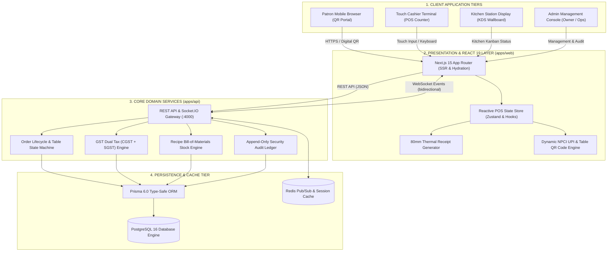
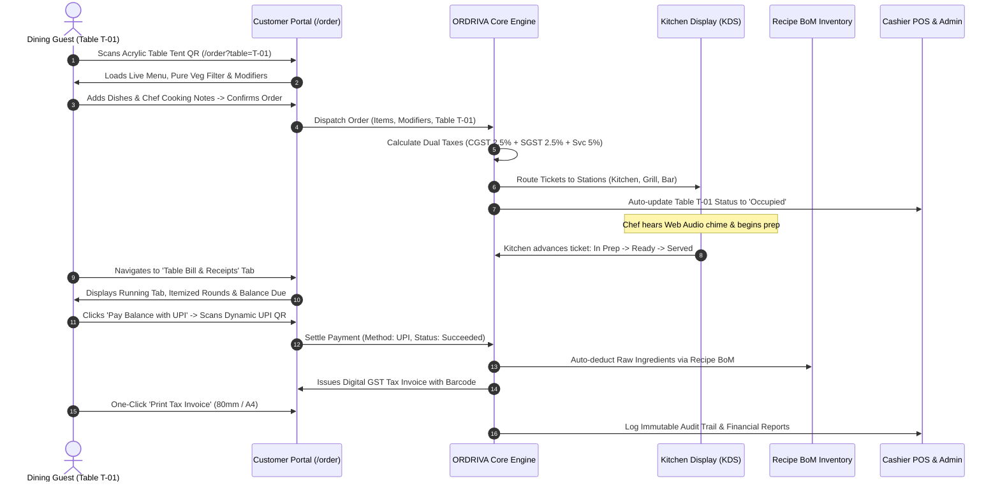
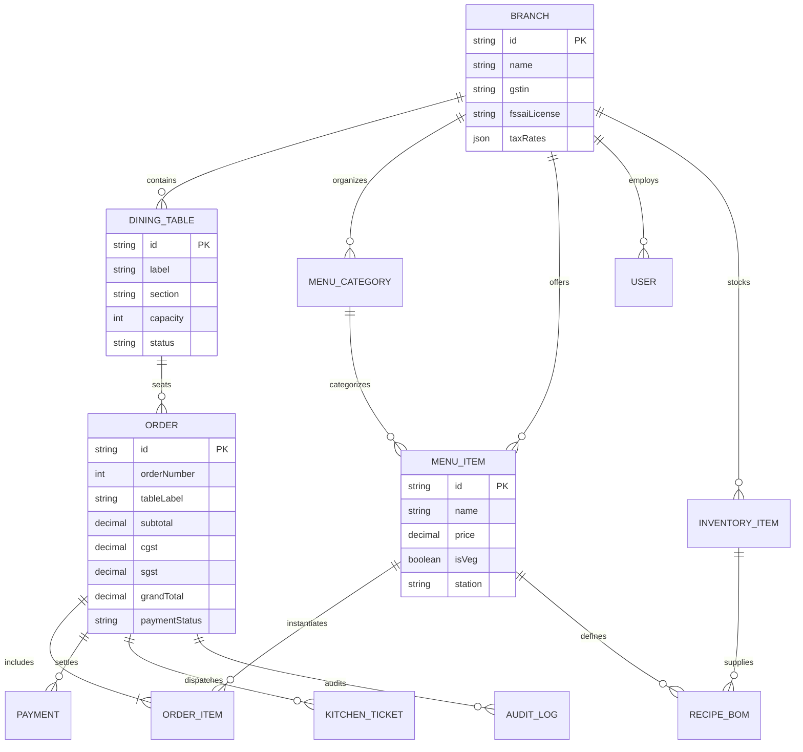

<div align="center">

  

  <br />
  <br />

  <p align="center">
    <strong>Enterprise Restaurant Operating System, Touch POS, KDS &amp; Contactless Dining Platform</strong>
  </p>

  <p align="center">
    <a href="https://nextjs.org"></a>
    <a href="https://react.dev"></a>
    <a href="https://www.typescriptlang.org"></a>
    <a href="https://tailwindcss.com"></a>
    <a href="https://www.prisma.io"></a>
    <a href="https://www.postgresql.org"></a>
    <a href="https://socket.io"></a>
    
    
  </p>

  <p align="center">
    <a href="#-executive-summary">Executive Summary</a> •
    <a href="#-system-architecture">Architecture Diagrams</a> •
    <a href="#-order--dining-lifecycle">Lifecycle Sequence</a> •
    <a href="#-customer-dining-portal">Customer Portal</a> •
    <a href="#-core-operating-modules">Core Modules</a> •
    <a href="#-repository-structure">Folder Structure</a> •
    <a href="#-quick-start-guide">Quick Start</a>
  </p>

  <hr />
</div>

## 📌 Executive Summary

**ORDRIVA** is a modern, enterprise-grade restaurant operating system connecting guest dining tables, touch cashier counters, kitchen prep lines, recipe inventory ledgers, and financial tax audits into a unified, high-performance platform.

Designed for high-throughput hospitality environments, ORDRIVA provides sub-300ms cashier response times, resilient offline capability, strict decimal monetary calculations (`NUMERIC(14,2)`), dual GST compliance (CGST + SGST + Service Charge), and instant NPCI UPI digital payments.

```
┌────────────────────────────────────────────────────────────────────────────────────────┐
│                                 ORDRIVA RESTAURANT OS                                  │
├─────────────────────────┬──────────────────────────┬───────────────────────────────────┤
│   ADMIN & MANAGEMENT    │     STAFF & CASHIER      │        CUSTOMER EXPERIENCE        │
│   • Executive KPI Board │     • 40px Touch POS     │        • Contactless QR Dining    │
│   • Multi-Branch Admin  │     • KDS Station Kanban │        • Live Order Status        │
│   • Recipe BoM Stock    │     • Table Floor Map    │        • Running Tab & E-Bill     │
│   • GST Statutory Audit │     • 80mm Bill Printing │        • UPI QR & Tax Invoice     │
│   • Z-Report Financials │     • Sound Chime Alerts │        • Vacant Tables Seating    │
└─────────────────────────┴──────────────────────────┴───────────────────────────────────┘
```

---

## 🏛️ System Architecture

ORDRIVA is engineered as a high-performance modular monolith with clean domain boundaries, multi-tenant branch isolation, and real-time bi-directional event distribution via WebSockets.



---

## 🔄 Order & Dining Lifecycle

The complete transaction workflow from contactless table scan to kitchen dispatch, instant UPI settlement, automated recipe stock deduction, and tax compliance:



---

## 🗄️ Database Entity-Relationship Model



---

## 📱 Customer Dining Portal (`/order`)

The customer-facing application is organized into 4 intuitive tabs with full mobile responsiveness:

| Tab | Feature Set | Technical Capabilities |
| :--- | :--- | :--- |
| 🍽️ **Food &amp; Drinks Menu** | Interactive Catalog | Category filter carousel, search autocomplete, pure veg toggle, modal-based modifiers (crusts, toppings, spice levels), and floating cart drawer. |
| 🧾 **Table Bill &amp; Receipts** | Running Tab &amp; GST Invoices | Live table financial statement, chronological order round history (R1, R2...), instant UPI payment QR, and printable GST Tax Invoice modal. |
| 📱 **Table QR Menu &amp; Stand** | Contactless QR Generator | Dynamic high-res QR code for active table, companion sharing via WhatsApp/Web Share, and printable 4×6" acrylic table tent stand mockup. |
| 🪑 **Live Tables &amp; Seating** | Real-Time Seating Map | Floor status counters (Vacant vs. Occupied vs. Reserved), section and capacity filters, and one-tap **"Sit at Table &amp; Order"** quick-seat action. |

---

## ⚡ Core Operating Modules

### 1. 🖥️ Touch Cashier POS Terminal (`/pos`)
* **Ergonomic Counter Workflow:** Large 44px touch-friendly targets built for peak counter rush hours.
* **Denomination Shortcuts:** Fast cash tender buttons (₹500, ₹1000, ₹2000, Exact) with real-time Change Calculation.
* **Dynamic UPI QR Engine:** On-the-fly NPCI UPI QR code generation compatible with Google Pay, PhonePe, and Paytm.
* **80mm Thermal Receipt Printing:** Browser and serial printer-ready monochrome tax invoices formatted to GST guidelines.

### 2. 👨‍🍳 Kitchen Display System (`/kitchen`)
* **3-Column Kanban Board:** Real-time ticket lifecycle tracking: **New Orders**, **In Preparation**, and **Ready for Pickup**.
* **Station Filtering:** Instant routing by prep station (*All Stations*, *Hot Kitchen*, *Grill & Fryer*, *Bar & Beverage*).
* **Chromatic Aging Alerts:** Visual color shifts highlight ticket wait times (Green `<10m`, Amber `10–20m`, Red `>20m`).
* **Web Audio Sound Chime:** Automatic audio notification triggers when new orders are placed.

### 3. 🪑 Floor Plan &amp; Table Manager (`/tables`)
* **Multi-Section Floor Visualization:** Organize tables across *Main Dining Room*, *Garden Terrace*, and *VIP Lounge*.
* **Live Occupancy Tracking:** Four distinct states: `Available` (Vacant), `Occupied`, `Reserved`, and `Billed`.
* **Elapsed Dining Timers:** Monitor active seating duration and launch POS transactions with a single click.

### 4. 📦 Recipe Bill-of-Materials Inventory (`/inventory`)
* **Automated Ingredient Depletion:** Order settlements automatically deduct exact gram/ml ingredient quantities.
* **Low-Stock Warnings:** Real-time alerts when raw items reach minimum safe reorder thresholds.
* **Stock Movement Journal:** Log supplier deliveries, prep spoilage, and stock adjustments with reason tracking.

### 5. 📊 Sales, Taxes &amp; Financial Analytics (`/reports`)
* **Executive Metrics:** Daily Gross Sales, Net Revenue, Average Order Value (AOV), and Tax Collections.
* **Tender Distribution:** Real-time payment method breakdown (UPI vs. Cash vs. Card).
* **Top Selling Dishes:** Performance analysis by volume sold and total revenue contribution.
* **End-of-Day Register Closing (Z-Report):** Instant shift reconciliation and CSV report export.

### 6. 🛡️ Immutable Security Audit Trail (`/audit`)
* **Tamper-Evident Ledger:** Captures manager overrides, bill cancellations, manual price mutations, and discount grants with timestamps and actor IDs.

---

## 👑 Management &amp; Admin Portal

* **Admin-Exclusive Session:** Single-tenant administrative mode locked to **Vikram Malhotra** (`admin@ordriva.com`).
* **System Console Popover:** Replaced unstyled browser dropdowns with a glassmorphic Administrative Console popover.
* **Enterprise Palette:** Precision color tokens adhering to user specifications:
  * Primary Blue `#3B82F6` (Electric Blue)
  * Sky Blue `#60A5FA` (Interactive Highlights)
  * Violet `#A78BFA` (Administrative Role Badges)
  * Obsidian Navy `#0B1120` (Glassmorphic Header)

---

## 🎨 Design Tokens &amp; Color System

| Token | Hex | Visual | Purpose &amp; Role |
| :--- | :---: | :---: | :--- |
| **Primary Blue** | `#3B82F6` |  | Primary call-to-action buttons, active navigation states, POS checkout |
| **Sky Blue Accent** | `#60A5FA` |  | Subtitles, interactive glows, status pills, hover states |
| **Violet Accent** | `#A78BFA` |  | Administrator role badges, special KPI cards, sparkles |
| **Obsidian Header** | `#0B1120` |  | Top glassmorphic navigation bar, executive cards, dark modal headers |
| **Canvas Background** | `#F8FAFC` |  | High-contrast neutral canvas for maximum staff readability under bright light |
| **Success Emerald** | `#16A34A` |  | Vacant tables, settled payments, healthy inventory levels |
| **Warning Amber** | `#D97706` |  | Occupied dining tables, kitchen tickets aging &gt;10m |
| **Danger Rose** | `#DC2626` |  | Critical inventory stockouts, voids, overdue tickets |

---

## 📁 Repository Structure

```
ORDRIVA/
├── 📁 apps/
│   ├── 🌐 web/                              # Next.js 15 App Router Frontend (:3000)
│   │   ├── 📁 public/                       # High-Resolution Vector Assets
│   │   │   ├── ordriva-logo.svg             # Primary Vector Lockup (Cloche + Wordmark)
│   │   │   └── ordriva-mark.svg             # Gold Cloche Vector Emblem
│   │   └── 📁 src/
│   │       ├── 📁 app/                      # Application Route Handlers
│   │       │   ├── 📊 page.tsx              # Executive Dashboard & Admin Center
│   │       │   ├── ⚡ pos/                  # Touch POS Terminal with UPI & Denominations
│   │       │   ├── 👨‍🍳 kitchen/              # Kitchen Display System (KDS Kanban)
│   │       │   ├── 🪑 tables/               # Floor Plan Layout & Table Status Manager
│   │       │   ├── 📱 order/                # Customer QR Portal (Menu, Bills, QR Stand, Tables)
│   │       │   ├── 🧾 orders/               # Order History Ledger & 80mm Print Receipts
│   │       │   ├── 📋 menu/                 # Menu Catalog, Categories & Modifiers
│   │       │   ├── 📦 inventory/            # Recipe BoM Stock Deductions & Alerts
│   │       │   ├── 📈 reports/              # Financial Analytics, Taxes & Z-Report
│   │       │   ├── 🛡️ audit/                # Immutable Security Audit Trail
│   │       │   └── ⚙️ settings/             # GSTIN, Tax Rates & Printer Configurations
│   │       ├── 📁 components/               # Atomic & Reusable Component Library
│   │       │   ├── OrdrivaLogo.tsx          # Multi-variant Responsive Vector Logo
│   │       │   ├── Navbar.tsx               # Glassmorphic Header & Admin Console Popover
│   │       │   └── Sidebar.tsx              # Primary Navigation Sidebar
│   │       ├── 📁 lib/                      # Core Business Logic & In-Memory Store
│   │       │   ├── store.tsx                # Zustand-style Reactive Store & Initial State
│   │       │   └── utils.ts                 # Currency Formatting & Tax Math
│   │       └── 📁 types/                    # Domain Type Definitions & Schema
│   │           └── index.ts                 # TypeScript Interfaces & Enums
│   │
│   └── 🔌 api/                              # Backend Monolith Service (:4000)
│       └── 📁 src/
│           ├── main.ts                      # Express / NestJS REST API + Socket.IO Server
│           └── ...                          # Domain Services, Controllers & WebSockets
│
├── 📁 prisma/                               # Database Tier (PostgreSQL 16)
│   ├── schema.prisma                        # Schema with Strict Numeric Types & UUIDs
│   └── seed.ts                              # Production-Grade Seed Data (Bistro & Grill)
│
├── 📁 docs/                                 # Enterprise Architecture & Operations Manuals
│   ├── PRD.md                               # Product Requirements Document
│   ├── TRD.md                               # Technical Requirements Document
│   ├── ARCHITECTURE.md                      # System Architecture & Technical RFC
│   ├── DATABASE.md                          # Database Entity Relationships & Indexing
│   ├── API.md                               # REST & WebSocket API Contracts
│   ├── SECURITY.md                          # RBAC, Idempotency & Threat Modeling
│   ├── TESTING.md                           # Acceptance Tests & Quality Gates
│   └── RUNBOOK.md                           # Production Operations & Disaster Recovery
│
├── docker-compose.yml                       # Multi-Container Compose Orchestration
└── package.json                             # Root Monorepo Configuration
```

---

## 🚀 Quick Start Guide

### Prerequisites
* **Node.js**: v20.x or higher
* **Package Manager**: `pnpm` (recommended) or `npm`
* **Database**: PostgreSQL 16 (or Docker Compose)

### 1. Installation

```bash
# Clone the repository
git clone https://github.com/your-org/ordriva.git
cd ordriva

# Install monorepo dependencies
pnpm install
```

### 2. Run the Full Stack Application

#### Option A: Running with Monorepo Scripts

```bash
# Terminal 1: Start Next.js Web Frontend
cd apps/web
pnpm run dev

# Terminal 2: Start API Server
cd apps/api
pnpm run dev
```

#### Option B: Running with Docker Compose

```bash
# Starts PostgreSQL (5432), Redis (6379), API (4000), and Next.js Web (3000)
docker-compose up -d
```

### 3. Application Directory URL Map

| Portal / Module | URL | Default Access |
| :--- | :--- | :--- |
| **Executive Admin Overview** | [http://localhost:3000](http://localhost:3000) | Administrator (`Vikram Malhotra`) |
| **Touch Cashier POS** | [http://localhost:3000/pos](http://localhost:3000/pos) | Cashier / Billing Staff |
| **Kitchen Display System (KDS)** | [http://localhost:3000/kitchen](http://localhost:3000/kitchen) | Kitchen Line / Head Chef |
| **Customer QR Portal** | [http://localhost:3000/order?table=T-01](http://localhost:3000/order?table=T-01) | Dining Guests (Table T-01) |
| **Floor Plan &amp; Table Management** | [http://localhost:3000/tables](http://localhost:3000/tables) | Host / Floor Manager |
| **Menu Catalog &amp; Customization** | [http://localhost:3000/menu](http://localhost:3000/menu) | Head Chef / Manager |
| **Inventory &amp; Recipe BoM** | [http://localhost:3000/inventory](http://localhost:3000/inventory) | Stock &amp; Inventory Manager |
| **GST &amp; Sales Reports** | [http://localhost:3000/reports](http://localhost:3000/reports) | Accountant / Auditor |
| **Security Audit Trail** | [http://localhost:3000/audit](http://localhost:3000/audit) | Security / Compliance Officer |
| **Backend REST API Health** | [http://localhost:4000/api/v1/health](http://localhost:4000/api/v1/health) | API Gateway |

---

## 📄 License &amp; Attribution

ORDRIVA is engineered for enterprise culinary and hospitality operations. Released under the **MIT License**.  
All brand identities, trademarks, and logos are property of their respective owners.
