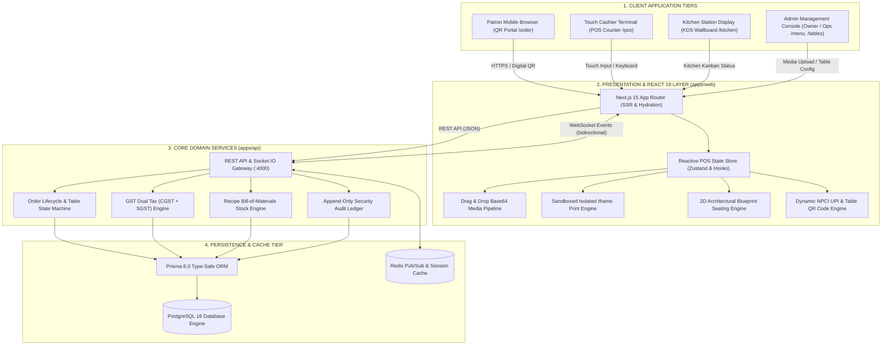
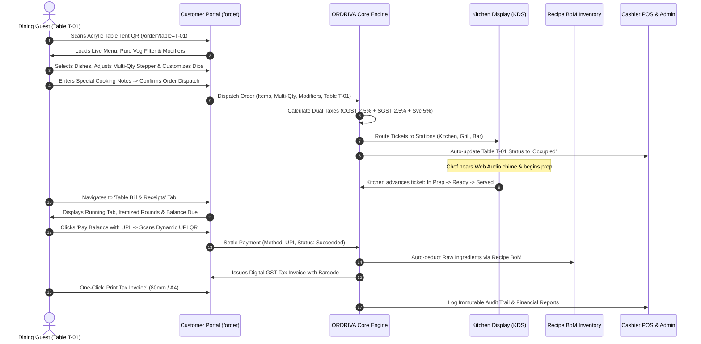
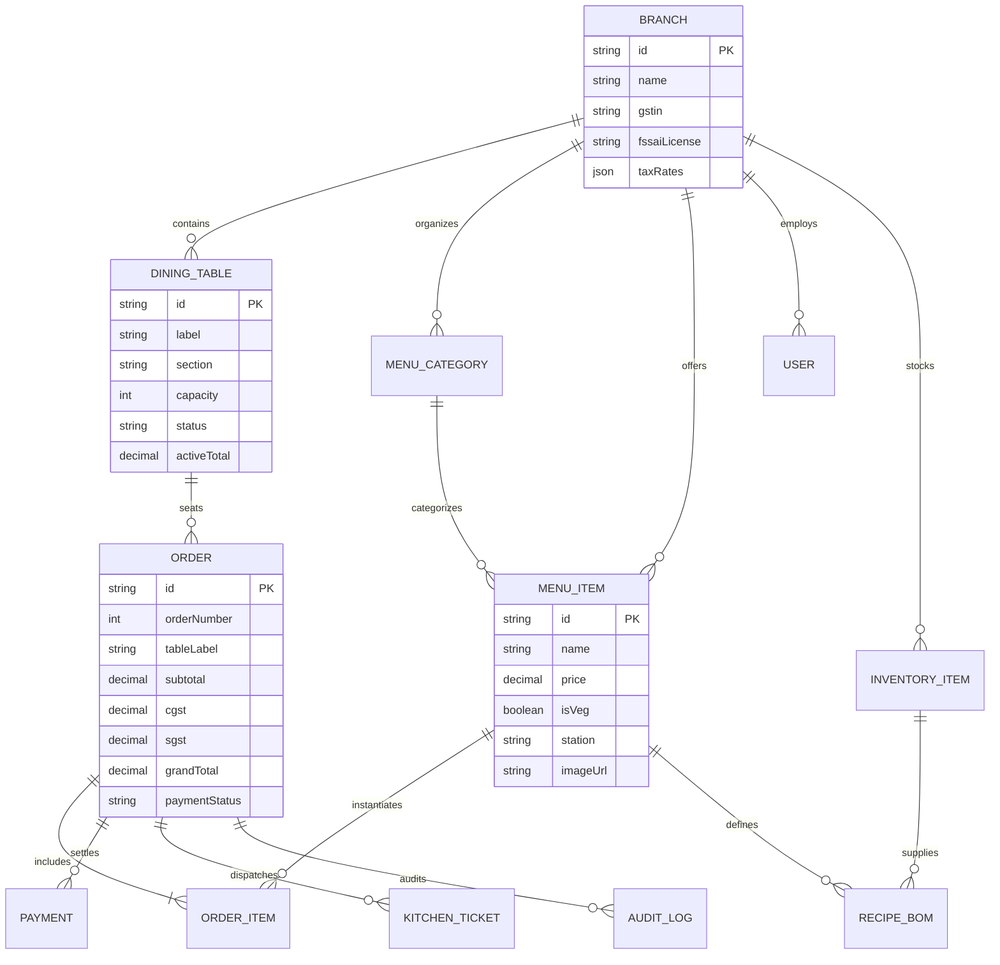

<div align="center">

  

  <br />
  <br />

  <p align="center">
    <strong>Enterprise Restaurant Operating System, Touch POS, KDS &amp; Contactless Dining Platform</strong>
  </p>

  <p align="center">
    <a href="https://nextjs.org"></a>
    <a href="https://react.dev"></a>
    <a href="https://www.typescriptlang.org"></a>
    <a href="https://tailwindcss.com"></a>
    <a href="https://www.prisma.io"></a>
    <a href="https://www.postgresql.org"></a>
    <a href="https://socket.io"></a>
    
    
    
  </p>

  <p align="center">
    <a href="#-executive-summary">Executive Summary</a> •
    <a href="#-system-architecture">Architecture Diagrams</a> •
    <a href="#-order--dining-lifecycle">Lifecycle Sequence</a> •
    <a href="#-customer-dining-portal">Customer Portal</a> •
    <a href="#-core-operating-modules">Core Modules</a> •
    <a href="#-usability-heuristics--accessibility">Usability &amp; Design System</a> •
    <a href="#-repository-structure">Folder Structure</a> •
    <a href="#-quick-start-guide">Quick Start</a>
  </p>

  <hr />
</div>

## 📌 Executive Summary

**ORDRIVA** is a modern, enterprise-grade restaurant operating system connecting guest dining tables, touch cashier counters, kitchen prep lines, recipe inventory ledgers, and financial tax audits into a unified, high-performance platform.

Designed for high-throughput hospitality environments, ORDRIVA provides sub-300ms cashier response times, resilient offline capability, strict decimal monetary calculations (`NUMERIC(14,2)`), dual GST compliance (CGST + SGST + Service Charge), instant NPCI UPI digital payments, drag-and-drop culinary media management, 2D architectural seating floor plans, and an isolated high-resolution table stand print engine.

```
┌────────────────────────────────────────────────────────────────────────────────────────┐
│                                 ORDRIVA RESTAURANT OS                                  │
├─────────────────────────┬──────────────────────────┬───────────────────────────────────┤
│   ADMIN & MANAGEMENT    │     STAFF & CASHIER      │        CUSTOMER EXPERIENCE        │
│   • Executive KPI Board │     • 44px Touch POS     │        • Contactless QR Dining    │
│   • Multi-Branch Admin  │     • KDS Station Kanban │        • Multi-Item Quantity Stepper│
│   • Media Drag & Drop   │     • 2D Architectural Map│       • Live Order Round History │
│   • Recipe BoM Stock    │     • 80mm Bill Printing │        • Running Tab & E-Bill     │
│   • GST Statutory Audit │     • Sound Chime Alerts │        • Instant UPI QR & Invoice │
│   • Z-Report Financials │     • Isolated Print QR  │        • Real-Time Table Seating  │
└─────────────────────────┴──────────────────────────┴───────────────────────────────────┘
```

---

## 🏛️ System Architecture

ORDRIVA is engineered as a high-performance modular monolith with clean domain boundaries, multi-tenant branch isolation, and real-time bi-directional event distribution via WebSockets.



---

## 🔄 Order & Dining Lifecycle

The complete transaction workflow from contactless table scan to kitchen dispatch, multi-item customization, instant UPI settlement, automated recipe stock deduction, and tax compliance:



---

## 🗄️ Database Entity-Relationship Model



---

## 📱 Customer Dining Portal (`/order`)

The mobile-first digital dining portal for restaurant patrons scanning table QR codes:

| Tab | Feature Set | Technical Capabilities |
| :--- | :--- | :--- |
| 🍽️ **Food &amp; Drinks Menu** | Interactive Catalog with Multi-Item Stepper | Category filter carousel, search autocomplete, pure veg toggle, modal-based modifiers (dips, crusts, toppings, spice levels), **inline multi-item quantity steppers (`[-] Qty [+]`)**, and live total price computation. |
| 🧾 **Table Bill &amp; Receipts** | Running Tab &amp; GST Invoices | Live table financial statement, chronological order round history (R1, R2...), instant UPI payment QR, and printable GST Tax Invoice modal. |
| 🪑 **Live Tables &amp; Seating** | Real-Time Seating Map | Floor status counters (Vacant vs. Occupied vs. Reserved), section and capacity filters, and one-tap **"Sit at Table &amp; Order"** quick-seat action. |

### How a Customer Accesses and Orders:
1. **QR Scan**: Guest scans the QR stand on their table (e.g. `http://localhost:3000/order?table=T-01`).
2. **Multi-Item Selection**: 
   - Tap **"+ Add to Order"** directly on any dish card to increment quantity instantly with inline counters.
   - For customizable dishes (e.g. *Truffle Parmesan Fries*), the modal opens with a dedicated quantity stepper and choices for artisanal dips (+₹40 Truffle Aioli, +₹30 Peri Peri Mayo, +₹60 Melted Cheddar).
3. **Instant Kitchen Dispatch**: Guest submits order with custom chef notes. Tickets route in real-time to KDS prep lines.
4. **Live Running Tab**: Guest can re-order in rounds (R1 appetizers, R2 mains). The running bill updates instantaneously.
5. **Contactless UPI Settlement**: Guest scans the dynamic UPI QR directly from the screen, pays via any UPI app (GPay, PhonePe, Paytm), and receives a verified GST tax invoice.

---

## ⚡ Core Operating Modules

### 1. 🖨️ Table QR Stands &amp; Print Studio (`/tables/qr`)
* **Isolated Direct Print Engine:** Uses sandboxed, offscreen iframes (`executePrintStand` & `executePrintBatchStands`) with custom CSS `@page { size: 4in 6in; margin: 0; }` to eliminate browser layout interference and ensure flawless single and multi-page printing.
* **Dual Aesthetic Themes:**
  * **🌙 Dark Acrylic (Luxury Obsidian):** Rich obsidian background (`#0B1120`), gold accents, gold cloche vector badge, and high-contrast white QR matrix with gold corner targets. Ideal for fine dining, rooftop lounges, and cocktail bars.
  * **☀️ Clean White (Minimalist Crisp):** Ultra-clean white background with sharp dark borders and high-contrast scan matrix. Ideal for bright cafes, bakeries, and high-volume lunch bistros.
* **Batch Print All Stands:** One-click batch generation prints all 10 floor tables in a single print job with automated page breaks.
* **High-Res PNG Export:** Client-side canvas rasterization allows instant PNG download for custom acrylic fabricators and vinyl sticker printers.

### 2. 📋 Menu &amp; Catalog Management (`/menu`)
* **Drag &amp; Drop Media Uploader:** Direct file drag-and-drop zone with instant local file browsing (`FileReader.readAsDataURL`). Automatically encodes food photos into embedded Base64 data URLs with instant visual preview and one-click removal.
* **Preset Photo Quick-Selectors:** One-click shortcuts for high-definition culinary stock photos across all categories (Pizza, Burger, Fries, Salmon, Pasta, Crostini, Mocktail, Cold Brew, Cake, Tiramisu).
* **16:9 Full-Bleed Showcase Cards:** Modern hero image presentation with floating glassmorphic dietary tags (`Pure Veg` / `Non-Veg`), kitchen station badges (`Kitchen`, `Grill`, `Bar`), and live stock status toggles (`In Stock` / `Out of Stock`).
* **Catalog Analytics Ribbon:** Real-time metrics bar displaying Total Active Dishes, Veg vs. Non-Veg split, Kitchen/Grill/Bar station distribution, and Stock Readiness percentage.
* **Elevated "+ Add New Dish" Card:** Prominent dashed hero card on the grid for quick, frictionless catalog expansion.

### 3. 🪑 Floor Plan &amp; Architectural Table Manager (`/tables`)
* **2D Architectural Seating Blueprint:**
  * **2-Guest Bistro Tables:** Circular tables (`w-16 h-16 rounded-full`) with dual curved perimeter chair indicators.
  * **4-Guest Dining Tables:** Rounded square tables (`w-24 h-14 rounded-2xl`) with four perimeter chair indicators.
  * **8 to 10-Guest Banquets:** Elongated boardroom tables (`w-32 h-14 rounded-2xl`) with distributed multi-seat chair rows.
* **Dynamic State-Reactive Geometry:**
  * 🟠 **Occupied:** Chairs and surfaces illuminated in warm amber glow with live dining timer and guest name.
  * 🔵 **Reserved:** Sapphire blue chairs with upcoming reservation notice.
  * 🟣 **Billed:** Velvet purple chairs with folio summary and check presented indicator.
  * 🟢 **Available:** Serene slate table and chairs ready for immediate walk-in seating.
* **Executive Floor Analytics Ribbon:**
  * Live seating capacity counter (`6 / 50 Guests Seated`).
  * Floor utilization percentage with micro-progress bar.
  * Ready for seating indicator with vacant table count.
  * Active running dining tabs revenue sum (₹).
* **Zero Label Hyphen Wrapping:** Precision-calibrated responsive grid (`grid-cols-1 sm:grid-cols-2 lg:grid-cols-3 xl:grid-cols-4`) and `whitespace-nowrap font-black` typography ensuring table labels (`T-01` through `T-10`, `VIP-1`, `VIP-2`) never wrap at hyphens.
* **High-Affordance POS Actions:** Solid blue primary **"Take Order"** button with hover micro-scale and secondary **"Manage"** button triggering the table status management drawer.

### 4. 🖥️ Touch Cashier POS Terminal (`/pos`)
* **Ergonomic Counter Workflow:** Large 44px touch-friendly targets built for peak counter rush hours.
* **Denomination Shortcuts:** Fast cash tender buttons (₹500, ₹1000, ₹2000, Exact) with real-time Change Calculation.
* **Dynamic UPI QR Engine:** On-the-fly NPCI UPI QR code generation compatible with Google Pay, PhonePe, and Paytm.
* **80mm Thermal Receipt Printing:** Browser and serial printer-ready monochrome tax invoices formatted to statutory GST guidelines.

### 5. 👨‍🍳 Kitchen Display System (`/kitchen`)
* **3-Column Kanban Board:** Real-time ticket lifecycle tracking: **New Orders**, **In Preparation**, and **Ready for Pickup**.
* **Station Filtering:** Instant routing by prep station (*All Stations*, *Hot Kitchen*, *Grill & Fryer*, *Bar & Beverage*).
* **Chromatic Aging Alerts:** Visual color shifts highlight ticket wait times (Green `<10m`, Amber `10–20m`, Red `>20m`).
* **Web Audio Sound Chime:** Automatic audio notification triggers when new orders are placed.

### 6. 📦 Recipe Bill-of-Materials Inventory (`/inventory`)
* **Automated Ingredient Depletion:** Order settlements automatically deduct exact gram/ml ingredient quantities.
* **Low-Stock Warnings:** Real-time alerts when raw items reach minimum safe reorder thresholds.
* **Stock Movement Journal:** Log supplier deliveries, prep spoilage, and stock adjustments with reason tracking.

### 7. 📊 Sales, Taxes &amp; Financial Analytics (`/reports`)
* **Executive Metrics:** Daily Gross Sales, Net Revenue, Average Order Value (AOV), and Tax Collections.
* **Tender Distribution:** Real-time payment method breakdown (UPI vs. Cash vs. Card).
* **Top Selling Dishes:** Performance analysis by volume sold and total revenue contribution.
* **End-of-Day Register Closing (Z-Report):** Instant shift reconciliation and CSV report export.

### 8. 🛡️ Immutable Security Audit Trail (`/audit`)
* **Tamper-Evident Ledger:** Captures manager overrides, bill cancellations, manual price mutations, and discount grants with timestamps and actor IDs.

---

## 🎯 Usability Heuristics &amp; Design System Compliance

ORDRIVA is rigorously engineered around Nielsen Norman Usability Heuristics and WCAG 2.1 AA accessibility guidelines:

| Usability Heuristic | Engineering Implementation &amp; Safeguards |
| :--- | :--- |
| **Consistency &amp; Standards** | • Standardized unified CTA terminology (`"Launch POS"`) across header navigation and hero cards.<br>• Standardized badge tokens across sidebar navigation (`rounded-full px-2 py-0.5 text-[10px] border`).<br>• Status semaphoring: Actionable `Ready` tickets rendered in conventional Emerald Green (`bg-emerald-50 text-emerald-700`). |
| **State Visibility &amp; Feedback** | • Live floor status legend complete with all 4 table states (`Available`, `Occupied`, `Reserved`, `Billed`).<br>• Fully decoded semantic state tags equipped with `aria-hidden="true"` and `role="listitem"`. |
| **Visual Hierarchy &amp; Affordance** | • High-contrast dark button surface for `Kitchen KDS` (`bg-slate-900/80 hover:bg-slate-900`) with keyboard focus rings.<br>• Ambient logo watermarks dialed down to `opacity-5` with `aria-hidden="true"` to eliminate contrast vibration behind action buttons.<br>• Optical alignment: Added `px-2` to `<th>Status</th>` to align directly with badge text baselines. |
| **Data Integrity &amp; Calculation** | • Fixed order item aggregation: Computes `totalQty` with accurate remaining breakdowns (`3 items (Name +2)`).<br>• Explicit flexbox separation (`gap-2`) preventing merged order type and table badge tokens (`Dine In [T-02]`). |
| **Typographic Discipline** | • Streamlined 21 disparate color classes into a strict 6-tier token scale (`slate-900`, `slate-600`, `slate-500`, `emerald-700`, `amber-700`, `rose-600`). |

---

## 👑 Management &amp; Admin Portal

* **Admin-Exclusive Session:** Single-tenant administrative mode locked to **Vikram Malhotra** (`admin@ordriva.com`).
* **Cleaned Enterprise Identity:** Timeless luxury vector lockup with metallic gold cloche emblem and Cinzel/Inter typography, free from transient version pill badges.
* **System Console Popover:** Replaced unstyled browser dropdowns with a glassmorphic Administrative Console popover.
* **Stabilized Navigation:** Fixed viewport layout (`h-screen overflow-hidden`) with dedicated scrolling modules and stabilized sidebar navigation with active indicator bar (`w-1 bg-[#3B82F6] rounded-r-full`).
* **Enterprise Palette:** Precision color tokens adhering to user specifications:
  * Primary Blue `#3B82F6` (Electric Blue)
  * Sky Blue `#60A5FA` (Interactive Highlights)
  * Violet `#A78BFA` (Administrative Role Badges)
  * Obsidian Navy `#0B1120` (Glassmorphic Header)

---

## 🎨 Design Tokens &amp; Color System

| Token | Hex | Visual | Purpose &amp; Role |
| :--- | :---: | :---: | :--- |
| **Primary Blue** | `#3B82F6` |  | Primary call-to-action buttons, active navigation states, POS checkout |
| **Sky Blue Accent** | `#60A5FA` |  | Subtitles, interactive glows, status pills, hover states |
| **Violet Accent** | `#A78BFA` |  | Administrator role badges, special KPI cards, sparkles |
| **Obsidian Header** | `#0B1120` |  | Top glassmorphic navigation bar, executive cards, dark modal headers |
| **Canvas Background** | `#F8FAFC` |  | High-contrast neutral canvas for maximum staff readability under bright light |
| **Success Emerald** | `#16A34A` |  | Vacant tables, settled payments, healthy inventory levels |
| **Warning Amber** | `#D97706` |  | Occupied dining tables, kitchen tickets aging &gt;10m |
| **Danger Rose** | `#DC2626` |  | Critical inventory stockouts, voids, overdue tickets |

---

## 📱 Omni-Device & Mobile-First Architecture

ORDRIVA is architected to deliver a responsive, touch-optimized experience spanning **smartphones (360px+)**, **handheld POS Android/iOS terminals (e.g., Sunmi, Clover, Toast)**, **kitchen bump-bar tablets (iPad, Galaxy Tab)**, and **wide desktop cashier monitors**:

* **Fixed Safe-Area Mobile Tab Bar (`MobileBottomNav.tsx`)**: High-frequency staff bottom tab bar on `< md` screens (Overview, POS, KDS, Tables, and More Drawer) with native iOS safe-area inset support (`env(safe-area-inset-bottom)`).
* **Slide-Over Navigation Drawer (`Navbar.tsx`)**: Reactive off-canvas drawer accessible via hamburger button or bottom "More" tab, providing 1-tap access to all 11 restaurant operational modules, branch switching, and root admin profiles.
* **Dual-Mode Touch POS (`/pos`)**: On screens `< lg`, POS switches dynamically between Menu Browsing and Order Cart via a top segmented controller and a sticky floating bottom trigger (`🛒 View Order Cart • ₹Total →`), while preserving side-by-side split panels on desktop screens.
* **Adaptive KDS Kanban (`/kitchen`)**: Seamlessly shifts from high-density multi-column desktop Kanban to a clean vertical feed with horizontal station filter bars on handheld tablets and mobile screens.
* **Horizontal Scroll Containment**: All tabular data (orders, raw material inventories, security audit logs) and filter ribbons utilize `.no-scrollbar` overflow wrappers to prevent viewport horizontal blowout on narrow displays.
* **WCAG Touch Target Compliance**: All buttons, stepper controls, and table cards conform to 44×44px minimum touch targets with haptic tap feedback states.

---

## 📁 Repository Structure

```
ORDRIVA/
├── 📁 apps/
│   ├── 🌐 web/                              # Next.js 15 App Router Frontend (:3000)
│   │   ├── 📁 public/                       # High-Resolution Vector Assets
│   │   │   ├── ordriva-logo.svg             # Primary Vector Lockup (Cloche + Wordmark, 440×100)
│   │   │   └── ordriva-mark.svg             # Gold Cloche Vector Emblem
│   │   └── 📁 src/
│   │       ├── 📁 app/                      # Application Route Handlers
│   │       │   ├── 📊 page.tsx              # Executive Dashboard & Admin Center (Heuristic Audited)
│   │       │   ├── ⚡ pos/                  # Touch POS Terminal with UPI & Denominations
│   │       │   ├── 👨‍🍳 kitchen/              # Kitchen Display System (KDS Kanban)
│   │       │   ├── 🪑 tables/               # 2D Architectural Seating Blueprint & Floor Map
│   │       │   │   └── 🖨️ qr/               # Isolated Table QR Stand Print Studio
│   │       │   ├── 📱 order/                # Customer QR Portal (Menu, Multi-Qty, Bills, Tables)
│   │       │   ├── 🧾 orders/               # Order History Ledger & 80mm Print Receipts
│   │       │   ├── 📋 menu/                 # Menu Catalog, Drag & Drop Media & Modifiers
│   │       │   ├── 📦 inventory/            # Recipe BoM Stock Deductions & Alerts
│   │       │   ├── 📈 reports/              # Financial Analytics, Taxes & Z-Report
│   │       │   ├── 🛡️ audit/                # Immutable Security Audit Trail
│   │       │   └── ⚙️ settings/             # GSTIN, Tax Rates & Printer Configurations
│   │       ├── 📁 components/               # Atomic & Reusable Component Library
│   │       │   ├── OrdrivaLogo.tsx          # Multi-variant Responsive Vector Logo (4.4 aspect)
│   │       │   ├── Navbar.tsx               # Glassmorphic Header & Off-Canvas Mobile Drawer
│   │       │   ├── Sidebar.tsx              # Stabilized Sidebar with Unified Token Badges
│   │       │   └── MobileBottomNav.tsx      # Fixed Mobile Bottom Tab Bar (iOS Safe Area)
│   │       ├── 📁 lib/                      # Core Business Logic & In-Memory Store
│   │       │   ├── store.tsx                # Zustand-style Reactive Store & Initial State
│   │       │   └── utils.ts                 # Currency Formatting & Tax Math
│   │       └── 📁 types/                    # Domain Type Definitions & Schema
│   │           └── index.ts                 # TypeScript Interfaces & Enums
│   │
│   └── 🔌 api/                              # Backend Monolith Service (:4000)
│       └── 📁 src/
│           ├── main.ts                      # Express / NestJS REST API + Socket.IO Server
│           └── ...                          # Domain Services, Controllers & WebSockets
│
├── 📁 prisma/                               # Database Tier (PostgreSQL 16)
│   ├── schema.prisma                        # Schema with Strict Numeric Types & UUIDs
│   └── seed.ts                              # Production-Grade Seed Data (Bistro & Grill)
│
├── 📁 docs/                                 # Enterprise Architecture & Operations Manuals
│   ├── PRD.md                               # Product Requirements Document
│   ├── TRD.md                               # Technical Requirements Document
│   ├── ARCHITECTURE.md                      # System Architecture & Technical RFC
│   ├── DATABASE.md                          # Database Entity Relationships & Indexing
│   ├── API.md                               # REST & WebSocket API Contracts
│   ├── SECURITY.md                          # RBAC, Idempotency & Threat Modeling
│   ├── TESTING.md                           # Acceptance Tests & Quality Gates
│   └── RUNBOOK.md                           # Production Operations & Disaster Recovery
│
├── docker-compose.yml                       # Multi-Container Compose Orchestraction
└── package.json                             # Root Monorepo Configuration
```

---

## 🚀 Quick Start Guide

### Prerequisites
* **Node.js**: v20.x or higher
* **Package Manager**: `pnpm` (recommended) or `npm`
* **Database**: PostgreSQL 16 (or Docker Compose)

### 1. Installation

```bash
# Clone the repository
git clone https://github.com/your-org/ordriva.git
cd ordriva

# Install monorepo dependencies
pnpm install
```

### 2. Run the Full Stack Application

#### Option A: Running with Monorepo Scripts

```bash
# Terminal 1: Start Next.js Web Frontend
cd apps/web
pnpm run dev

# Terminal 2: Start API Server
cd apps/api
pnpm run dev
```

#### Option B: Running with Docker Compose

```bash
# Starts PostgreSQL (5432), Redis (6379), API (4000), and Next.js Web (3000)
docker-compose up -d
```

### 3. Application Directory URL Map

| Portal / Module | URL | Default Access |
| :--- | :--- | :--- |
| **Executive Admin Overview** | [http://localhost:3000](http://localhost:3000) | Administrator (`Vikram Malhotra`) |
| **Touch Cashier POS** | [http://localhost:3000/pos](http://localhost:3000/pos) | Cashier / Billing Staff |
| **Kitchen Display System (KDS)** | [http://localhost:3000/kitchen](http://localhost:3000/kitchen) | Kitchen Line / Head Chef |
| **Customer QR Portal** | [http://localhost:3000/order?table=T-01](http://localhost:3000/order?table=T-01) | Dining Guests (Table T-01) |
| **Floor Plan &amp; Table Management** | [http://localhost:3000/tables](http://localhost:3000/tables) | Host / Floor Manager |
| **Table QR Stands &amp; Print Studio** | [http://localhost:3000/tables/qr](http://localhost:3000/tables/qr) | Admin / Restaurant Manager |
| **Menu Catalog &amp; Media Management** | [http://localhost:3000/menu](http://localhost:3000/menu) | Head Chef / Manager |
| **Inventory &amp; Recipe BoM** | [http://localhost:3000/inventory](http://localhost:3000/inventory) | Stock &amp; Inventory Manager |
| **GST &amp; Sales Reports** | [http://localhost:3000/reports](http://localhost:3000/reports) | Accountant / Auditor |
| **Security Audit Trail** | [http://localhost:3000/audit](http://localhost:3000/audit) | Security / Compliance Officer |
| **Backend REST API Health** | [http://localhost:4000/api/v1/health](http://localhost:4000/api/v1/health) | API Gateway |

---

## 📄 License &amp; Attribution

ORDRIVA is engineered for enterprise culinary and hospitality operations. Released under the **MIT License**.  
All brand identities, trademarks, and logos are property of their respective owners.
